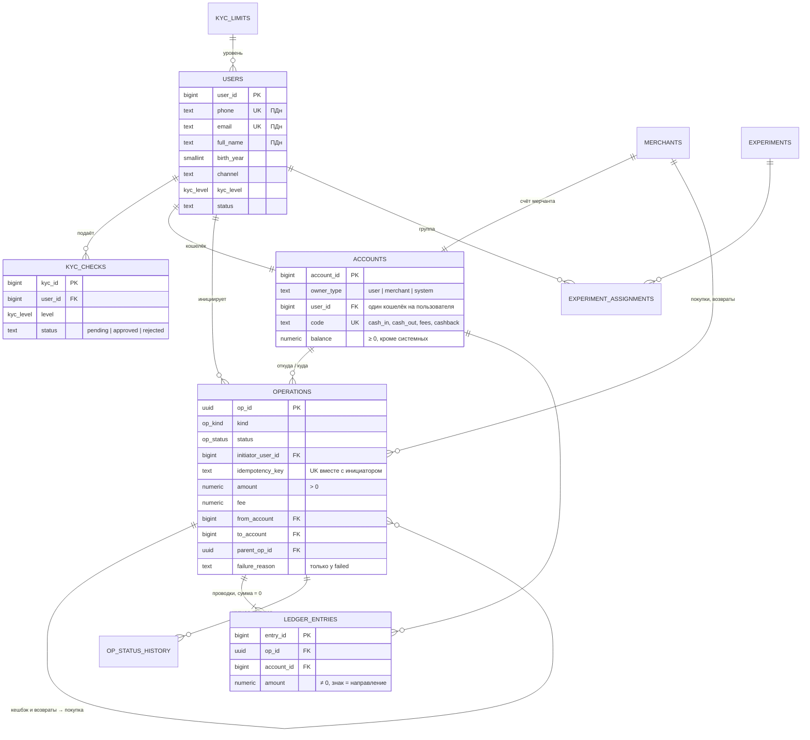
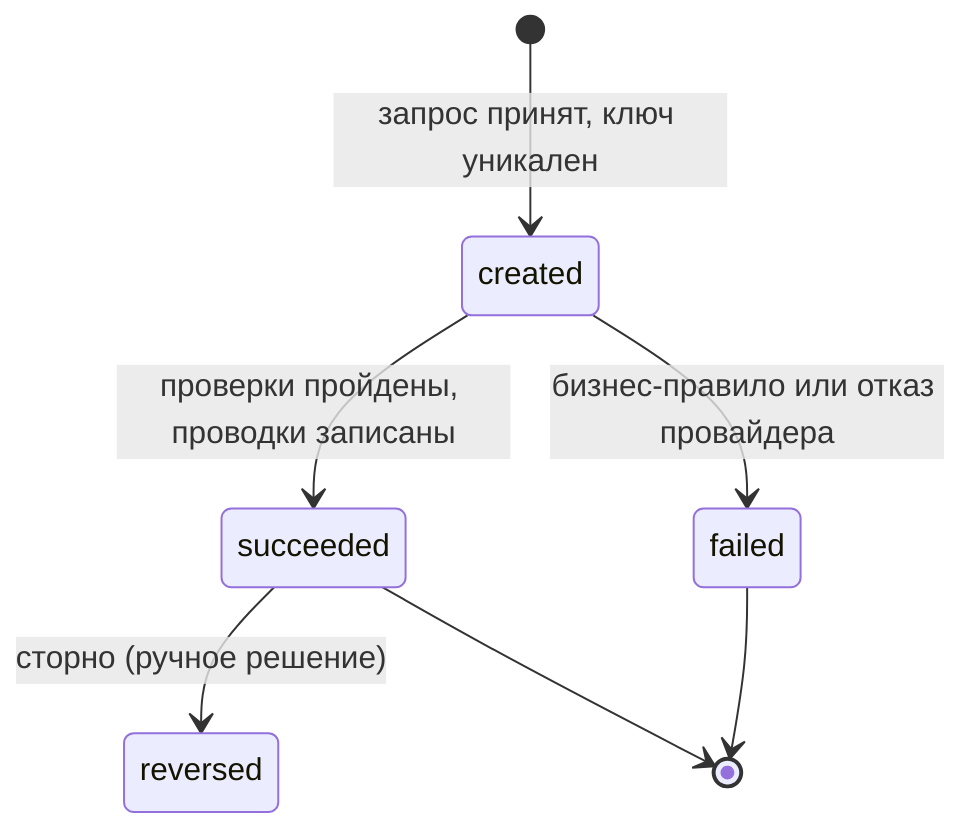
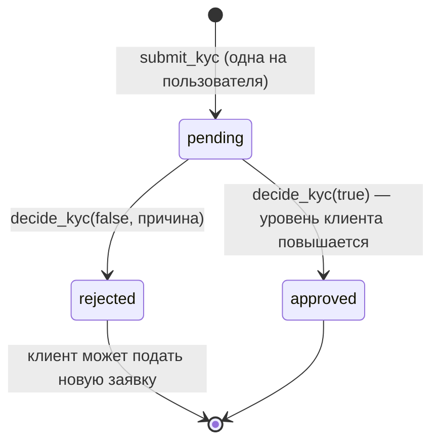
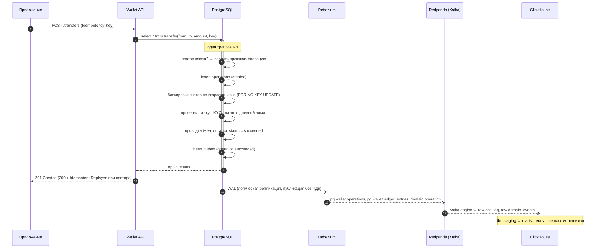
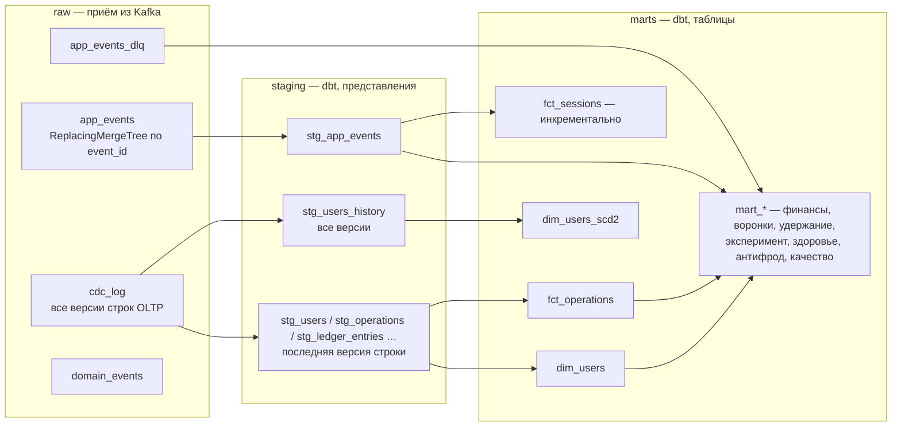

# Модель данных и поведение системы

## ER-модель (OLTP, PostgreSQL)

Почему так:
- **Двойная запись.** Деньги не «появляются» в поле `balance`: каждое движение — пара проводок с суммой ноль.
  Пополнение уводит в минус системный счёт `cash_in`, поэтому сумма всех остатков в системе всегда 0 —
  это проверяет сверка. `balance` — денормализация для быстрых проверок лимитов; источник истины — проводки.
- **Отказ — тоже операция.** Аналитике нужны попытки, а не только успехи (доля отказов, причины, сбои провайдера).
- **Идемпотентность — ограничение БД**, а не проверка в коде: `unique (initiator_user_id, idempotency_key)`
  защищает и от одновременных повторов.

## Состояния операции

Переходы проверяет триггер `op_status_guard`; любой другой переход — ошибка. Журнал — `op_status_history`.

## Состояния заявки KYC

## Перевод: последовательность и надёжная доставка данных

Почему outbox, а не «записать в БД и отправить в Kafka из кода»: при падении сервиса между этими шагами событие
теряется или уходит без изменения данных. Outbox пишется в той же транзакции, а публикует его Debezium из WAL —
событие есть ровно тогда, когда есть изменение.

## Хранилище (ClickHouse)

